# HRig

A Windows desktop workspace for [OpenRig](https://github.com/mvschwarz/openrig). Arrange existing agent sessions with graphical tabs, splits, floating panels, and separate windows. Open project files and Git diffs alongside your agents.

## Screenshots

**Settings and coordinated themes**

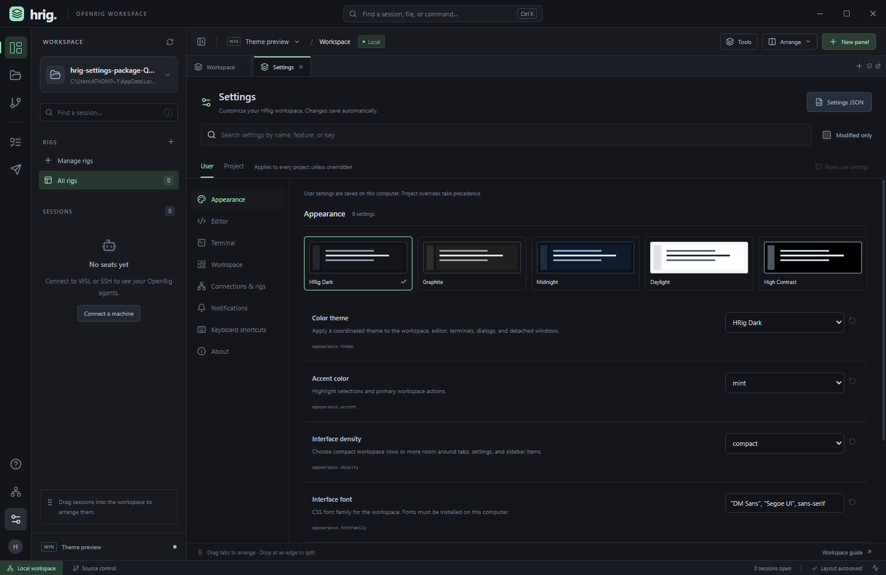

<details>
<summary>Daylight, Midnight, and narrow settings layouts</summary>

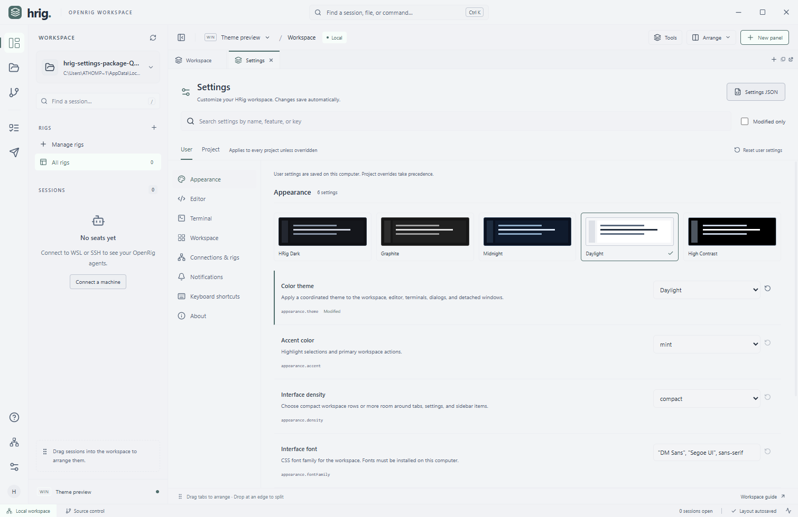

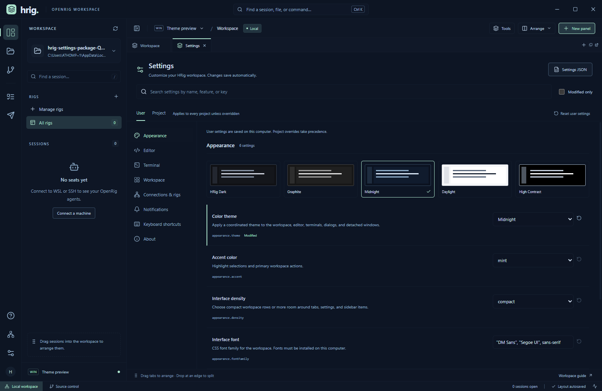

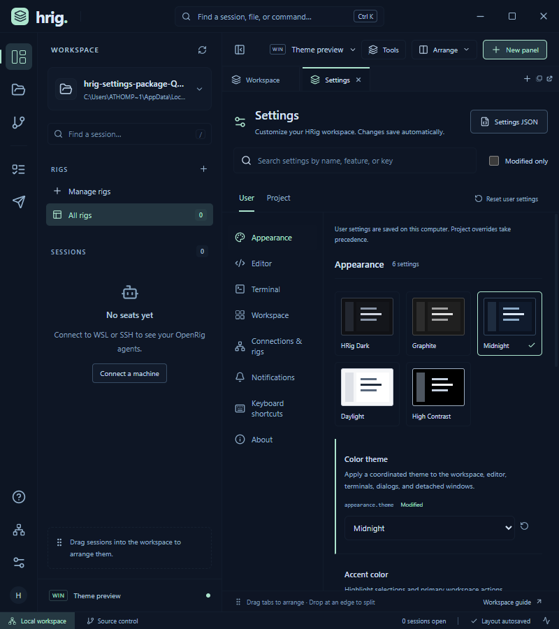

</details>


<details>
<summary>Community themes: Catppuccin, Nord, and Dracula</summary>

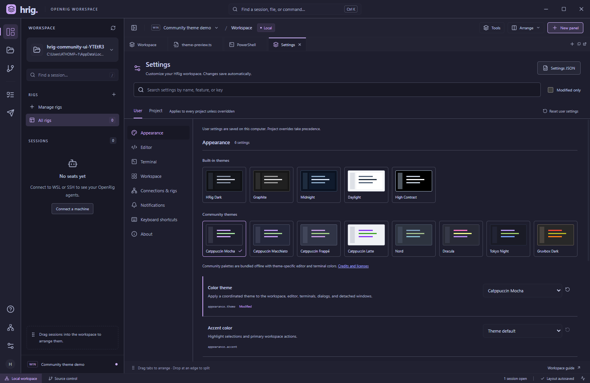

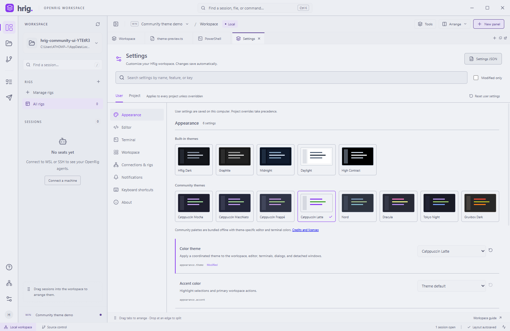

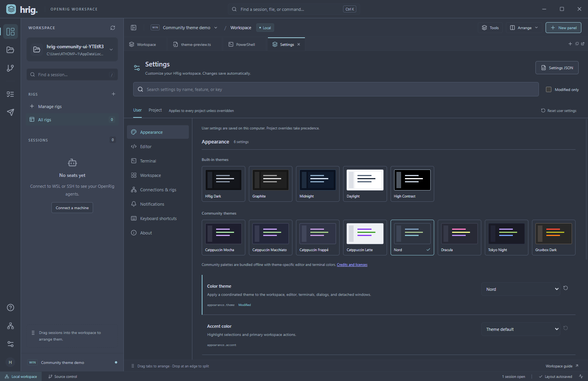

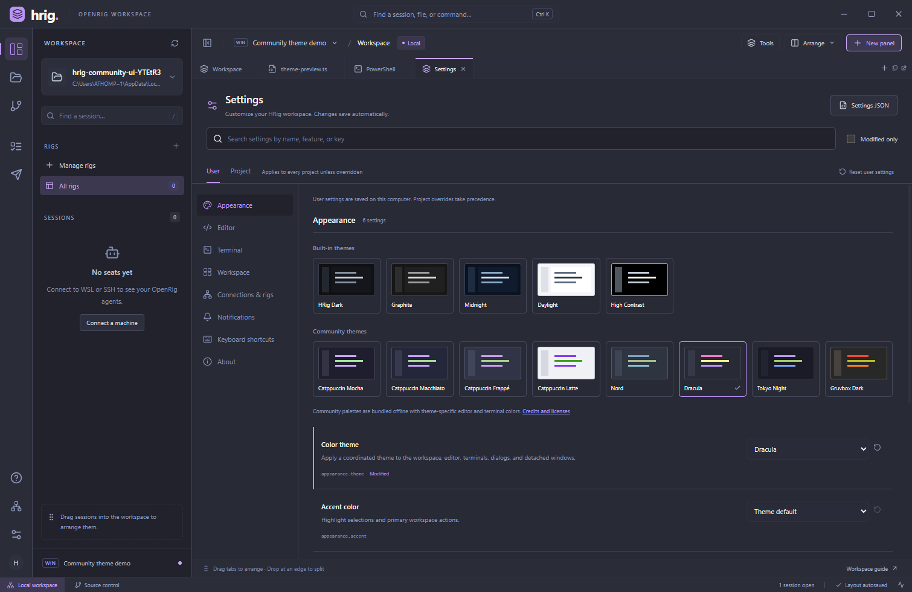

</details>

**Guided rig design**

The rig designer guides you from a goal to an editable team and a launch review. These screenshots use an isolated demonstration rig.

**Review the team before launching**

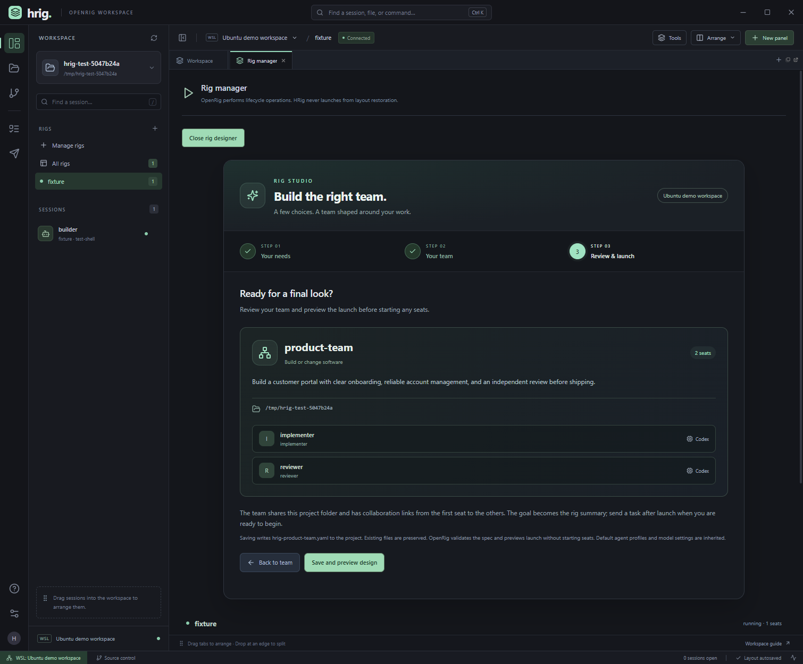

<details>
<summary>Choose your goal, type of work, and team size</summary>

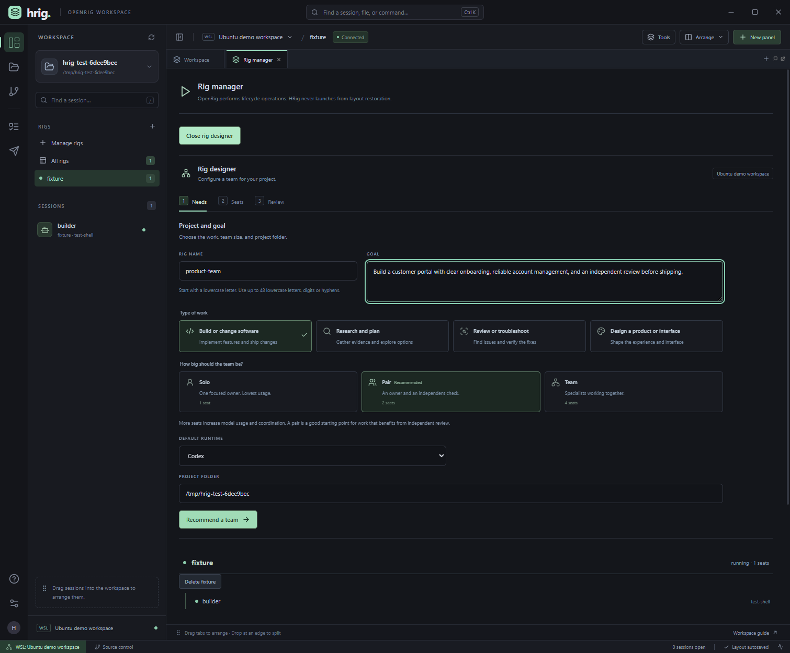

</details>

<details>
<summary>Customize agents and runtimes for each seat</summary>

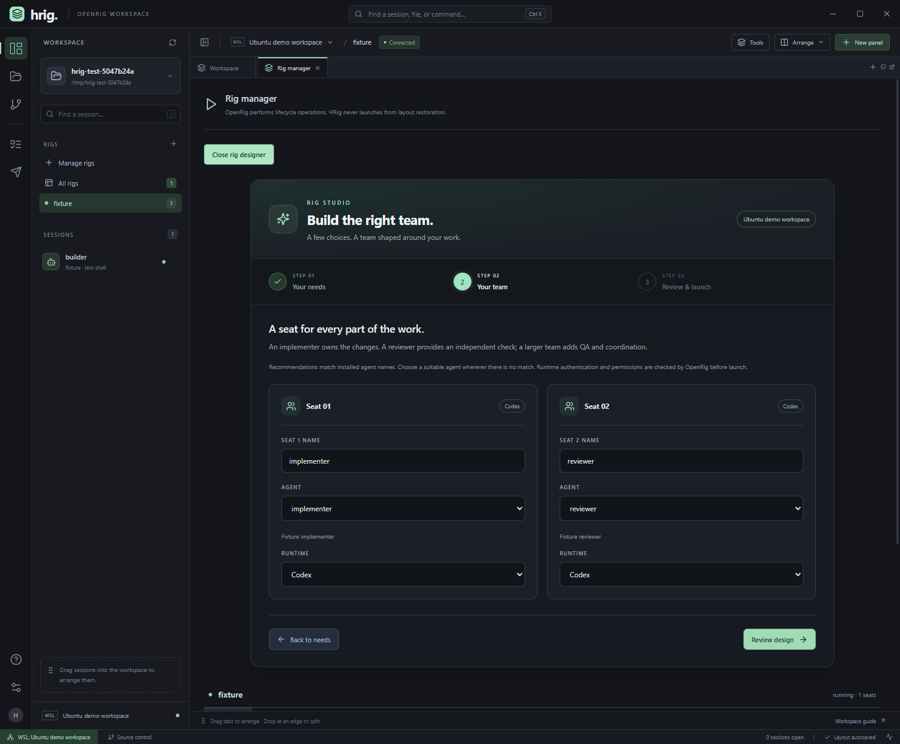

</details>

<details>
<summary>Use the designer in a narrow docked panel</summary>

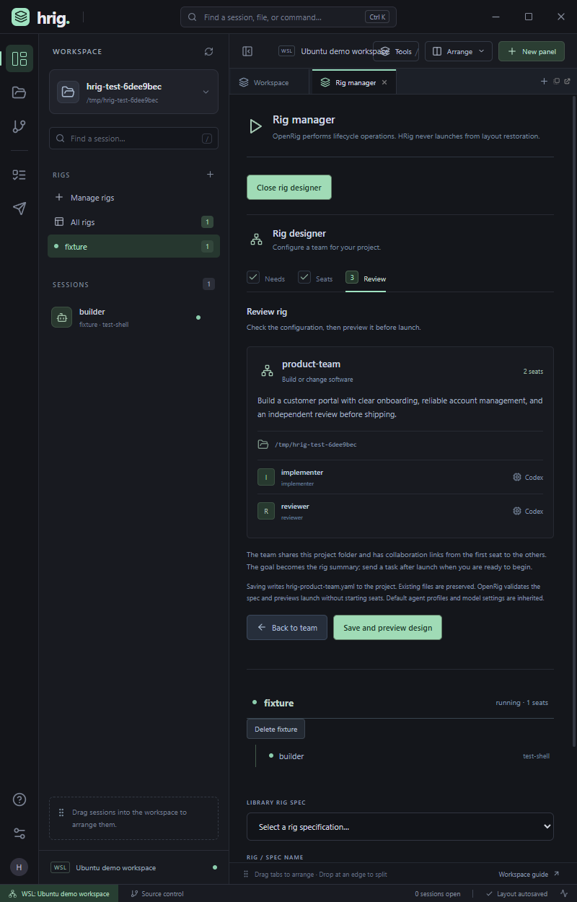

</details>

## Run the desktop app

Open **`release/HRig 0.7.1.exe`**. Close an older HRig instance first so the new version can take over the workspace. This is an unsigned, portable Windows x64 build; it does not require Node.js on Windows to run.

1. Choose **Connect a machine** and select a detected WSL distribution or enter an SSH alias / `user@hostname`.
2. Set the project path on that machine. Set an absolute OpenRig executable path if `rig` is not available in its login shell.
3. Existing rigs and seats appear in the sidebar. Click a seat to attach, or drag it directly into a split or tab group.
4. Use **Arrange** for Team, Focus, and Review presets, or save your own named layout.

The **Explorer** opens editable project files. **Source control** shows changed files with side-by-side diffs against HEAD. **New panel** adds shells, task queues, messages, and an activity view.

Source control and Review require a Git working tree. If the selected folder is your home directory or another non-repository folder, HRig shows **Open a Git project** with a **Choose project folder** button. It does not initialize a repository automatically. Other Git failures retain Git's actual error message instead of a Python traceback.

## Connections

- **Local Windows:** PowerShell, project files, and Git. OpenRig itself runs on Linux / WSL, so local mode does not discover rigs.
- **WSL:** uses `wsl.exe -d <distribution> --exec bash -lc ...`. OpenRig and its Node.js runtime must be installed **inside Linux**, rather than resolving to a Windows npm shim. Existing NVM installations are initialized inside HRig's command environment when necessary; HRig does not edit shell profiles or install dependencies. tmux is required for agent attachment; Python 3 is required for remote project files.
- **SSH:** uses Windows OpenSSH, including your SSH config, keys, agent, jump hosts, and optional port. Background discovery and file operations require non-interactive key / agent authentication. For first-time host-key acceptance or an interactive login, open a shell on that connection, then refresh rigs. HRig does not automatically accept host keys or store passwords.

Git must be installed on the machine hosting the project for source control. Distributions and explicit non-wildcard aliases in `~/.ssh/config` are detected; other SSH targets can be added manually.

## Arrange sessions

- Drag a panel tab onto another tab strip to group panels.
- Drop at a panel edge to create a split. Resize with the dividers.
- Use the **Float selected tab** or **Popout selected tab** buttons for floating panels or separate Windows windows.
- Double-click a tab-group background to maximize or restore it. Tab labels can be renamed.
- Connection, project, and rig each define a workspace. Each workspace remembers its layout automatically.
- Named layouts are available under **Arrange**. Saving the same name replaces that workspace's previous named arrangement.

Closing an agent panel only detaches its tmux client. It does not stop or relaunch the agent. Reopening attaches to the existing session. Ordinary PowerShell / Bash shells are app-owned processes and do not survive closing the app.

## Keyboard shortcuts

| Shortcut | Action |
| --- | --- |
| Ctrl K | Command center; search sessions, commands, and project filenames |
| Ctrl O | Open project directory |
| Ctrl B | Show / hide sidebar |
| Ctrl Shift T | New shell |
| Ctrl S | Save the focused editor file |
| Escape | Dismiss the current dialog or menu |

File search checks at most 20,000 files and returns up to 100 matches. Generated directories, dependencies, and symlinks are excluded. Text files up to 2 MB can be edited. File access is confined to the chosen project directory, including resolved symlink paths.

## Workspace tools in 0.5

Open **Tools** in the top toolbar, or use **Ctrl K** to find a tool.

| Tool | Workflow |
|---|---|
| Arrange workspace | See a layout thumbnail, choose a panel and destination group, split or group without dragging, equalize sizes, undo/redo arrangement changes, and save role-based templates. |
| Connection doctor | Check the real Node, OpenRig, tmux, Python and daemon environment. Connection/authentication failures include their cause. |
| Attention center | See served attention/startup problems and blocked tasks; click a seat to focus it. Windows notifications are off by default and deduplicated when enabled. |
| Task board | Filter by owner, text and state; inspect full task details; create work assigned to a seat. Handoffs are requested from the owning seat rather than impersonating it. |
| Review workspace | Select a feedback recipient, open a changed file beside sessions, collect file/line notes, and explicitly send feedback through OpenRig. Git changes belong to the project; HRig does not infer which agent authored them. |
| Project tools | Search text, create new text files and rename entries within the project. Save and close editors for a path before renaming it. |
| Problems | Inspect Monaco diagnostics from opened files and jump to their lines. |
| Ports and previews | Discover listening ports or enter one manually. SSH targets get a loopback-only managed tunnel. Preview tabs restore their remote port binding, rather than assuming an old local tunnel still exists. |
| Rig manager | Inspect rig/seat topology, browse rig specs, preview launch or restore, and confirm by typing the rig name. Stopping always requests a snapshot first and requires the same explicit confirmation. |

Role templates bind terminal slots by seat role/name in the selected rig. Missing roles stay visible as unfilled panels; no agent is created to fill one. Templates can be reused across projects and rigs. Arrangement undo is separate from editor undo; adding or closing panels resets arrangement history so closed sessions are not unexpectedly resurrected.

Seats retry failed attachments up to six times with bounded backoff, refresh the current session name using stable seat identity, and refresh after Windows resumes. These operations never launch agents. Saved main/popout window positions are brought back within connected monitor bounds.

Clean editor buffers reload detected disk changes. Dirty buffers preserve local text and offer a comparison or explicitly confirmed reload. Saves compare the last-read SHA-256 revision with disk and reject a stale write. This is a pre-write conflict check, not a filesystem transaction with other programs: another process writing concurrently during the final write remains outside HRig's control.

The roadmap and implementation evidence are tracked in [ROADMAP.md](ROADMAP.md).

## Develop

### iOS and Android companion (initial implementation)

Download the [Android companion prerelease](https://github.com/athompson-hoho/hrig/releases/tag/companion-android-preview.1) for the debug APK, checksum, matching source and host setup instructions. See the [proposed mobile releases](ROADMAP.md#mobile-companion-release-proposals) for planned improvements.

The companion lists rigs and seats, reads the latest 200 lines of a seat's terminal, shows active tasks, and sends messages to a selected seat. It uses the same OpenRig boundary as the desktop app. Terminal screens are read-only and refresh every four seconds; this version does not provide an interactive terminal, file editing, notifications, or rig lifecycle controls. It does not create or relaunch agents.

Save your WSL or SSH connections in the desktop app first. On the Windows HRig computer, build and start the companion gateway:

```powershell
npm run mobile:build
$env:HRIG_MOBILE_TOKEN = node -e "console.log(require('crypto').randomBytes(32).toString('hex'))"
$env:HRIG_MOBILE_HOST = '192.168.1.20' # Replace with this computer's LAN or Tailscale IPv4 address
npm run mobile:gateway
```

Read the pairing key with `$env:HRIG_MOBILE_TOKEN` in that same terminal before starting the gateway, or retain it privately when setting it. Enter `http://<computer-address>:5180` and that key in the companion. The key grants screen access and permission to send messages to all saved WSL/SSH connections. It stays in the phone app's memory, while only the host address is saved. Restarting the app requires pairing again. Change the environment key and restart the gateway to revoke access.

For LAN access, the phone must be on a network that can reach the computer, with inbound TCP 5180 allowed by the Windows firewall for that network. For Tailscale, connect both devices to the same tailnet and use the computer's Tailscale IP or MagicDNS name; tailnet policy must allow the connection. No Tailscale API keys or SSH keys are copied to the phone. The gateway defaults to loopback unless you explicitly set `HRIG_MOBILE_HOST`. `HRIG_MOBILE_PORT` overrides 5180 and `HRIG_DATA_DIR` selects a different desktop workspace directory. The gateway is a separate Node.js process and requires Node.js 22+; the portable desktop executable does not start it automatically.

HTTP on a LAN carries the key and session text without transport encryption. Use it only on a trusted network, or use Tailscale's encrypted network. For HTTPS, you can place the loopback gateway behind Tailscale Serve and use its HTTPS address. Browser clients must load the UI from the gateway's own origin; native apps use Capacitor HTTP. Native transport settings permit HTTP so user-entered private IPs work; HTTPS is preferred when available.

Native Android and iOS projects are included. The client bundle is packaged locally using [Capacitor's build and sync workflow](https://capacitorjs.com/docs/getting-started).

```powershell
npm run mobile:sync
npm run mobile:android # Android Studio; build and run on a device
npm run mobile:ios     # Xcode on macOS; configure signing and run on an iPhone
```

Android needs Android Studio and its SDK/JDK. iOS builds require macOS and Xcode. The Android debug APK has been built and tested through Orca on the Medium Phone API 37 emulator: invalid-key rejection, native HTTP pairing, sessions, terminal capture, task browsing, message receipt, rotation, disconnect, and re-pairing after process restart. Testing used the isolated fixture gateway below, not live agents. The test also verified light system-bar icons against the dark app background. iOS and physical-device LAN/Tailscale access still require validation; this repository does not include signed store packages. You can also open the gateway URL directly in a phone browser to try the client without installing an app. This implementation is inspired by the remote workspace workflow, with no dependency on Orca's private protocols.

`npm run test:mobile` checks the touch UI against a fixture gateway. Gateway authentication and operation boundaries are included in `npm test`.

For native Android testing with Orca, run `npm run mobile:sync`, then `android/gradlew.bat -p android assembleDebug` with `ANDROID_HOME` pointing to your SDK. Start the isolated gateway with `node tests/mobile/native-gateway.cjs`, attach your device using `orca emulator attach <device> --json`, install `android/app/build/outputs/apk/debug/app-debug.apk` with `orca emulator install`, and launch `dev.hrig.companion` with `orca emulator launch`. In an Android emulator use host address `http://10.0.2.2:5181` and fixture key `native-emulator-fixture-key-12345678`. The fixture supplies fake sessions and prints message receipts; it never contacts live rigs. Stop that gateway when testing is finished. This verifies the native HTTP bridge; separate LAN/Tailscale device tests are still needed.

Requires Windows x64 and Node.js 22 or newer.

```powershell
npm install
npm run dev
```

If package install scripts are disabled by your npm configuration and Electron has not been downloaded, run `node node_modules/electron/install.js` once. The Windows node-pty package includes native prebuilds.

```powershell
npm run build        # TypeScript check and production renderer
npm start            # Run the production build
npm test             # Transport, inventory, filesystem, and WSL integration
npm run test:e2e     # Real Electron desktop tests
npm run test:dev     # Development server / desktop integration
npm run test:package # Smoke-test the packaged app (after packaging)
npm run package      # Build portable Windows executable
npm run icons        # Regenerate the application icon from public/icon.svg
```

The WSL tests create and clean up uniquely named `/tmp/hrig-test-*` directories and tmux sessions. A test-only CLI fixture supplies OpenRig's JSON/action boundary; lifecycle and message tests write receipts only inside that fixture. They do not launch, stop or message live agents, or change your OpenRig installation. Desktop tests cover Windows PTYs, WSL/tmux attachment, six-session arrangement, history, role templates, attention, task assignment, confirmed lifecycle actions, session replacement, file conflicts, diagnostics, review feedback, previews, off-screen window recovery, and application restart. A live SSH server and OS notification delivery are not part of the automated environment.

## Architecture

- **Electron main process:** connection discovery, constrained IPC endpoints, Windows ConPTY sessions via node-pty, persistent workspace state, project filesystem access, and Git operations.
- **React renderer:** FlexLayout docking, xterm terminal views, and a locally bundled Monaco editor. The editor loads when a file is opened; there is no CDN dependency.
- **OpenRig boundary:** discovery, queue, messaging, specs and lifecycle commands are wrapped by constrained backend actions. Mutations verify advertised CLI flags and lifecycle actions require an explicit rig-name confirmation. Existing seats attach through `tmux attach-session -t '=SESSION'`.
- **Ownership:** OpenRig owns rigs, agents, coordination, and session persistence. HRig owns presentation and terminal attachments. HRig never calls `rig up` when restoring a panel.

Workspace metadata is stored in `%APPDATA%/hrig/workspace.json`, or the directory specified by `HRIG_DATA_DIR`. It contains connection definitions, project paths, panel layouts, and seat metadata, not passwords or terminal transcripts. Unsaved edit buffers stay in memory and are protected by close prompts.

## Current scope

The ten scoped improvements are integrated into the 0.5 preview. SSH password-based background operations, VS Code extensions, debugging, full remote language servers and editing rig specifications graphically remain outside this release. Task queries read the latest 1,000 active items across the host before applying rig/owner filters. External-file checks run every 2.5 seconds locally or 8 seconds remotely, plus on window focus. Notifications depend on Windows settings. Some servers intentionally disallow embedded previews; their frame policy remains authoritative. OpenRig policy can refuse mutations even when the CLI supports their flags; HRig surfaces that refusal without overriding ownership or permissions.

### Rig project folders (0.5.2)

Press Ctrl+O or click the project card to choose a working folder discovered from your live rig sessions. The selected rig's folders appear first; shared folders appear once with all associated rig names. Click a folder to open it without typing its path. Discovery uses the active connection (WSL or SSH) and only includes managed OpenRig sessions. Stopped sessions have no live folder to discover; manual paths and Windows Browse remain available.

### Rig designer and deletion (0.6.0)

Click **Manage rigs** in the session sidebar, or **Tools > Rig manager**. **Design a new rig** walks through the goal, work type, team size, runtime and project folder; recommends roles from the installed agent library; and lets you change every seat's agent and runtime. Recommendations use role-name matching, with explicit choices required for unmatched roles. Save and preview writes `hrig-<name>.yaml` (JSON syntax accepted by YAML) in the chosen project, then asks OpenRig to validate and plan it. Review the resulting warnings before typing the new rig name to launch. Changed designs require another preview. Existing rigs cannot be replaced through the wizard, and unrelated files are preserved. Agent paths refer to the current host's installed library; rerun the wizard if those agents move. The goal is saved as the summary; assign work through messages or tasks after launch.

Each rig has a **Delete** action showing its ID and affected seats. Type its name to confirm. HRig calls OpenRig's `down <id> --delete --snapshot --json`, which stops managed seats, attempts a snapshot and removes the rig record. The project folder and library spec are retained; restoring the deleted record by name is unavailable. OpenRig can refuse deletion; HRig displays that failure.

### Releases

Repository: https://github.com/athompson-hoho/hrig. Download portable Windows executables from its Releases page. Version-specific notes and source targets are tracked in `releases/`; each published executable has a SHA-256 checksum asset. The historical v0.1.0 tag preserves packaged application files because its original TypeScript source was not committed. Full editable source begins at v0.5.0.

To publish a prepared release, build and smoke-test the executable, add detailed notes and an entry to `releases/manifest.json`, commit the changes, then run `npm run release:publish -- <version>`. Use `--check` to validate without publishing. The publisher requires a public repository, verifies package/tag versions and remote asset hashes, and publishes only after uploads finish. It marks only the final manifest version as latest. Existing assets with different hashes are refused.

### Rig Studio visual update (0.6.1)

The designer uses a three-step progress indicator, visual work and team choices, agent seat cards, and a compact roster review. It adapts to narrow docked panels. Preview details are expandable while launch warnings remain visible.

### Wizard appearance (0.6.2)

The rig designer now follows the workspace tool panels: compact headings and steps, shared control styling, flat surfaces, restrained mint selections, and denser forms and seat layouts. The screenshots above show the updated interface.

### Settings and themes (0.7.0)

Open **Settings** from the activity rail, Tools, the command center, or **Ctrl+,**. Search 33 preferences across appearance, editor, terminal, workspace, connection/rig defaults, and notifications. User and local project scopes include modified filters, resets, and validated JSON import/export. Five palettes plus Follow Windows coordinate the app, editors, terminals, and detached panels. Changes to terminal appearance preserve the running session. See [SETTINGS.md](SETTINGS.md) for the feature plan, catalog, scope rules, and follow-up ideas.

### Community themes (0.7.1)

Appearance includes Catppuccin (Mocha, Macchiato, Frappe, Latte), Nord, Dracula, Tokyo Night, and Gruvbox Dark. Choose **Theme default** for the native accent, or retain a custom accent. Each adaptation coordinates the app, editor syntax, all 16 terminal colors, and detached panels; terminal themes can also be selected independently. Palettes and licenses ship offline. [Theme credits and source revisions](THEME_CREDITS.md).
